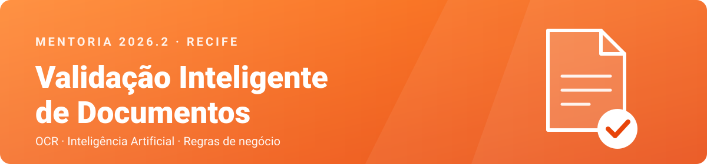
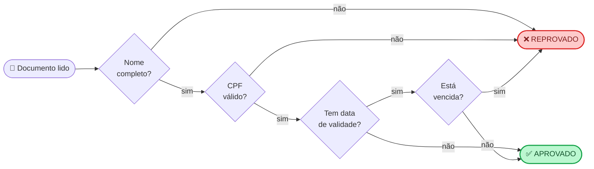

<div align="center">



<br>


**Do documento à decisão: leitura por OCR, extração por IA, validação por regras de negócio e consulta dos resultados.**

[🚀 Como rodar](#-como-rodar) · [📡 API](#-api-rest) · [⚖️ Regras](#️-regras-de-negócio) · [🧩 Arquitetura](#-arquitetura) · [🛠️ Problemas comuns](#️-problemas-comuns)

</div>

---

## 📑 Sumário

1. [🎯 O problema](#-o-problema)
2. [✨ O que o sistema faz](#-o-que-o-sistema-faz)
3. [🧩 Arquitetura](#-arquitetura)
4. [⚖️ Regras de negócio](#️-regras-de-negócio)
5. [🧰 Tecnologias](#-tecnologias)
6. [🚀 Como rodar](#-como-rodar)
7. [🖥️ Como usar](#️-como-usar)
8. [📡 API REST](#-api-rest)
9. [⚙️ Configuração](#️-configuração)
10. [📁 Estrutura do projeto](#-estrutura-do-projeto)
11. [🔬 Como o pipeline funciona](#-como-o-pipeline-funciona)
12. [🧪 Testes](#-testes)
13. [🛠️ Problemas comuns](#️-problemas-comuns)
14. [🔒 Segurança e LGPD](#-segurança-e-lgpd)
15. [🗺️ Próximos passos](#️-próximos-passos)

---

## 🎯 O problema

<p align="justify">
Muitas empresas ainda analisam documentos manualmente: pessoas leem formulários, contratos e comprovantes, identificam as informações e verificam se elas atendem às regras da empresa. Esse processo é demorado, gera retrabalho e aumenta o risco de erros.
</p>

<p align="justify">
<b>O desafio</b> deste projeto é automatizar esse processo. A solução recebe documentos digitais, usa <b>OCR</b> e <b>Inteligência Artificial</b> para extrair as informações, aplica <b>regras de negócio</b> para validá-las e disponibiliza o resultado de forma organizada para consulta e tomada de decisão.
</p>

### 📋 Definição do projeto

Respostas às 9 perguntas do material da mentoria:

| # | Pergunta | Resposta do projeto |
|:-:|----------|---------------------|
| 1 | 🎯 **Problema** | A validação manual de documentos gera atrasos, retrabalho e erros. |
| 2 | 👤 **Usuário** | Analista de cadastro / backoffice. |
| 3 | 📄 **Documento** | Documentos com nome e CPF (RG, CNH, comprovantes). |
| 4 | 🧾 **Dados extraídos** | Nome, CPF e data de validade (quando o documento tiver). |
| 5 | ⚖️ **Regras** | Nome completo, CPF válido e, se houver validade, documento não vencido. |
| 6 | ✅ **Aprovação** | Todas as regras aplicáveis atendidas. |
| 7 | ❌ **Rejeição** | Nome incompleto ou ausente, CPF inválido ou ausente, ou documento vencido. |
| 8 | 🔀 **Fluxo** | Upload → OCR → IA → Validação → Banco → Resultado. |
| 9 | 🏁 **MVP** | Upload de um documento, extração, validação e consulta do resultado. |

---

## ✨ O que o sistema faz

- 📤 **Recebe** PDF, PNG ou JPG (até 10 MB), por uma tela web ou pela API.
- 🖼️ **Trata a imagem** com OpenCV para melhorar a leitura.
- 🔤 **Lê o texto** com Tesseract (português). PDFs viram imagem antes (até 3 páginas).
- 🤖 **Extrai nome, CPF e data de validade** com IA (OpenAI ou Claude) ou, sem IA, com Regex.
- ⚖️ **Valida** com regras de negócio e decide **APROVADO** ou **REPROVADO**, explicando o motivo de cada regra.
- 🗄️ **Salva** o resultado no banco (H2 ou PostgreSQL).
- 🔎 **Disponibiliza** o histórico em tela, com filtro por status, e por API.

> [!TIP]
> Se a IA falhar (sem rede, chave inválida ou resposta fora do formato), o sistema usa automaticamente a extração por **Regex** como plano B. O processamento não para.

---

## 🧩 Arquitetura

```mermaid
flowchart LR
    A([📄 Documento<br/>PDF / imagem]):::doc --> B[⬆️ Upload<br/>API REST]:::step
    B --> C[🖼️ OpenCV<br/>trata a imagem]:::img
    C --> D[🔤 Tesseract<br/>lê o texto]:::ocr
    D --> E[🤖 IA ou Regex<br/>extrai os dados]:::ia
    E --> F[⚖️ Regras<br/>de negócio]:::rules
    F --> G[(🗄️ Banco<br/>de dados)]:::db
    G --> H([✅ Resultado<br/>consulta]):::out

    classDef doc fill:#f1f5f9,stroke:#64748b,color:#0f172a
    classDef step fill:#ffedd5,stroke:#f97316,color:#7c2d12
    classDef img fill:#dcfce7,stroke:#22c55e,color:#14532d
    classDef ocr fill:#ede9fe,stroke:#8b5cf6,color:#4c1d95
    classDef ia fill:#fef3c7,stroke:#f59e0b,color:#78350f
    classDef rules fill:#dbeafe,stroke:#3b82f6,color:#1e3a8a
    classDef db fill:#cffafe,stroke:#06b6d4,color:#164e63
    classDef out fill:#bbf7d0,stroke:#16a34a,color:#14532d
```



Cada etapa tem um papel claro: **preparar** (OpenCV) → **ler** (Tesseract) → **interpretar** (IA) → **validar** (Java) → **persistir** (banco).

---

## ⚖️ Regras de negócio

| Regra | Condição para ser atendida |
|-------|----------------------------|
| 👤 **Nome completo identificado** | O nome tem pelo menos duas palavras (nome e sobrenome). |
| 🪪 **CPF válido** | O CPF existe e passa na verificação dos dígitos verificadores. Não basta o formato: `111.111.111-11` é recusado. |
| 📅 **Data de validade** | **Só é verificada se o documento tiver uma.** Se tiver, não pode estar vencida (vale até o próprio dia da validade). |



> [!NOTE]
> **Sem data de validade**, a aprovação depende apenas de **CPF válido + nome completo**.

| Exemplo | Resultado |
|---------|:---------:|
| Nome completo + CPF válido, sem validade | 🟢 APROVADO |
| Nome completo + CPF válido + validade futura | 🟢 APROVADO |
| Nome completo + CPF válido + validade vencida | 🔴 REPROVADO |
| CPF inválido ou ausente | 🔴 REPROVADO |
| Apenas um nome, sem sobrenome | 🔴 REPROVADO |

---

## 🧰 Tecnologias

| Camada | Tecnologia | Função |
|--------|------------|--------|
| ☕ Linguagem | **Java 21** | Backend |
| 🌱 Framework | **Spring Boot 3.3** | API REST, injeção de dependências e JPA |
| 🖼️ Imagem | **OpenCV** (JavaCPP) | Escala de cinza, ampliação, remoção de ruído e binarização |
| 🔤 OCR | **Tesseract + Tess4J** | Transforma imagem em texto |
| 📄 PDF | **Apache PDFBox** | Converte páginas do PDF em imagem |
| 🤖 IA | **OpenAI** ou **Claude** (Anthropic) | Transforma o texto em JSON estruturado |
| 🔍 Sem IA | **Regex** (Java) | Extração por palavras-chave |
| 🗄️ Banco | **H2** (padrão) ou **PostgreSQL** | Guarda documentos e resultados |
| 🎨 Front end | HTML, CSS e JavaScript puros | Upload, resultado e histórico |
| 🐳 Infra | **Docker** e **Docker Compose** | Execução em contêiner |
| 🧪 Testes | **JUnit 5** | Regras, CPF e extração |

---

## 🚀 Como rodar

Há dois caminhos: **Docker** (mais simples, não precisa instalar Java nem Tesseract) ou **local**.

### 🐳 Opção A: Docker (recomendado)

> [!IMPORTANT]
> Instale o [Docker Desktop](https://www.docker.com/products/docker-desktop/) e **deixe-o aberto** (ícone verde, "Engine running") antes de rodar os comandos.

```bash
git clone https://github.com/lfcs92/proj-analise-validacao-documentos.git
cd proj-analise-validacao-documentos
docker compose up --build
```

A primeira execução leva alguns minutos, porque baixa imagens e dependências. Está pronto quando aparecer:

```
Started DocValidatorApplication in ... seconds
```

Depois, abra **http://localhost:8080** 🎉

| O que fazer | Comando |
|-------------|---------|
| ⏹️ Parar | `Ctrl + C` ou `docker compose down` |
| ▶️ Rodar em segundo plano | `docker compose up -d` |
| 📜 Ver logs | `docker compose logs -f app` |
| 🔨 Reconstruir após mudar o código | `docker compose up --build` |
| 🧹 Apagar tudo, inclusive o banco | `docker compose down -v` |

> [!TIP]
> Depois de atualizar o código, use `Ctrl + F5` no navegador para não carregar a tela antiga do cache.

O Docker sobe a aplicação e um PostgreSQL. O Tesseract (com português) já vem na imagem.

### 💻 Opção B: Local (sem Docker)

<details>
<summary><b>1️⃣ Instalar os programas</b> (clique para abrir)</summary>

<br>

| Sistema | Instalação |
|---------|-----------|
| 🪟 **Windows** | [JDK 21](https://adoptium.net), [Maven](https://maven.apache.org/download.cgi) (`winget install Apache.Maven`) e o Tesseract pelo instalador da [UB-Mannheim](https://github.com/UB-Mannheim/tesseract/wiki), marcando **Portuguese** em *Additional language data*. Adicione o Maven e o Tesseract ao `PATH`. |
| 🍎 **macOS** | `brew install openjdk@21 maven tesseract tesseract-lang` |
| 🐧 **Ubuntu/Debian** | `sudo apt install openjdk-21-jdk maven tesseract-ocr tesseract-ocr-por` |

Confirme, em um terminal novo:

```bash
java -version            # 21
mvn -version
tesseract --list-langs   # deve listar "por"
```

</details>

<details>
<summary><b>2️⃣ Informar onde está a pasta <code>tessdata</code></b> (clique para abrir)</summary>

<br>

A pasta precisa conter o arquivo `por.traineddata`.

| Sistema | Caminho comum |
|---------|---------------|
| 🪟 Windows | `C:\Program Files\Tesseract-OCR\tessdata` |
| 🍎 macOS | `/opt/homebrew/share/tessdata` |
| 🐧 Ubuntu | `/usr/share/tesseract-ocr/5/tessdata` (já é o padrão) |

```bash
# Git Bash / Linux / macOS
export TESSDATA_PATH="/usr/share/tesseract-ocr/5/tessdata"   # ajuste ao seu sistema

# Windows (PowerShell)
$env:TESSDATA_PATH="C:\Program Files\Tesseract-OCR\tessdata"
```

</details>

<details>
<summary><b>3️⃣ Rodar</b> (clique para abrir)</summary>

<br>

```bash
mvn test                 # opcional: roda os testes
mvn spring-boot:run
```

Abra **http://localhost:8080**. Por padrão usa o banco H2 em arquivo (`./data`), sem nenhuma configuração.

Para usar PostgreSQL local:

```bash
mvn spring-boot:run -Dspring-boot.run.profiles=postgres
```

</details>

### 🤖 Ligando a IA (opcional)

Sem configurar nada, o sistema usa **Regex**. Para usar IA:

**Docker:** crie um arquivo `.env` na raiz do projeto (ele já está no `.gitignore`):

```env
IA_PROVIDER=anthropic
ANTHROPIC_API_KEY=sk-ant-sua-chave
```

ou, para OpenAI:

```env
IA_PROVIDER=openai
OPENAI_API_KEY=sk-sua-chave
```

e rode `docker compose up`.

**Local:**

```bash
IA_PROVIDER=anthropic ANTHROPIC_API_KEY=sk-ant-... mvn spring-boot:run
IA_PROVIDER=openai    OPENAI_API_KEY=sk-...        mvn spring-boot:run
```

> [!WARNING]
> **Nunca** coloque chaves de API no código nem envie o arquivo `.env` ao Git.

---

## 🖥️ Como usar

### 🌐 Pela tela (http://localhost:8080)

1. 📤 Arraste o documento para a área de upload, ou clique para escolher.
2. ▶️ Clique em **Validar documento**.
3. 🔎 Veja o resultado: banner de aprovado ou reprovado, dados extraídos (o CPF aparece mascarado, com botão "mostrar") e a lista de regras com o motivo de cada uma.
4. 📚 No **Histórico**, veja os totais, filtre por status e clique numa linha para rever o resultado.

### 🧪 Para testar rápido

Crie uma imagem (por exemplo, um print de um Word) com estas linhas:

```
COMPROVANTE
Nome: João da Silva
CPF: 529.982.247-25
```

Resultado esperado: 🟢 **APROVADO** (CPF válido, nome completo, sem validade).

Para ver uma reprovação, troque o CPF por `123.456.789-00` ou inclua a linha `Validade: 10/05/2020`.

> [!TIP]
> Para o OCR funcionar bem, use imagens nítidas, retas e com largura acima de 1000 px.

---

## 📡 API REST

| Método | Rota | Descrição |
|:------:|------|-----------|
|  | `/api/documentos` | Envia o arquivo (`multipart/form-data`, campo `arquivo`), roda o pipeline e devolve o resultado (`201`). |
|  | `/api/documentos` | Lista os documentos, do mais recente ao mais antigo. Filtro opcional: `?status=APROVADO` ou `?status=REPROVADO`. |
|  | `/api/documentos/{id}` | Busca um documento pelo id (`404` se não existir). |

```bash
curl -F "arquivo=@documento.png" http://localhost:8080/api/documentos
curl "http://localhost:8080/api/documentos?status=REPROVADO"
```

<details>
<summary><b>📦 Exemplo de resposta</b> (clique para abrir)</summary>

```json
{
  "id": "6f1c1f6e-8c2b-4b7e-9d0a-2a6f0c9d1e11",
  "arquivo": "documento.png",
  "status": "APROVADO",
  "dados": {
    "nome": "João da Silva",
    "cpf": "529.982.247-25",
    "dataValidade": null
  },
  "regras": [
    { "regra": "Nome completo identificado", "atendida": true, "mensagem": "Nome: João da Silva" },
    { "regra": "CPF válido", "atendida": true, "mensagem": "CPF com dígitos verificadores corretos" },
    { "regra": "Data de validade", "atendida": true, "mensagem": "Documento sem data de validade: aprovado apenas por CPF e nome" }
  ],
  "criadoEm": "2026-11-25T21:30:00Z"
}
```

</details>

**Códigos de erro** (formato `ProblemDetail`):

| Código | Quando acontece |
|:------:|-----------------|
| `400` | Arquivo vazio ou formato não suportado. |
| `404` | Documento não encontrado. |
| `413` | Arquivo acima de 10 MB. |
| `500` | Falha no processamento. |

---

## ⚙️ Configuração

Arquivo: `src/main/resources/application.yml`. Principais variáveis de ambiente:

| Variável | Padrão | Descrição |
|----------|--------|-----------|
| `TESSDATA_PATH` | `/usr/share/tesseract-ocr/5/tessdata` | Pasta do Tesseract com `por.traineddata`. |
| `IA_PROVIDER` | `regex` | `regex`, `openai` ou `anthropic`. |
| `OPENAI_API_KEY` / `OPENAI_MODEL` | vazio / `gpt-4o-mini` | Chave e modelo da OpenAI. |
| `ANTHROPIC_API_KEY` / `ANTHROPIC_MODEL` | vazio / `claude-sonnet-5-5` | Chave e modelo do Claude. |
| `DB_URL` / `DB_USER` / `DB_PASSWORD` | PostgreSQL local | Usados com o profile `postgres`. |

**Perfis de banco:** sem profile usa **H2** (arquivo em `./data`); com `postgres` usa **PostgreSQL**. No Docker Compose, o profile `postgres` já vem ativado.

---

## 📁 Estrutura do projeto

```
.
├── 🐳 Dockerfile                 # Build + execução (Java 21 + Tesseract português)
├── 🐳 docker-compose.yml         # Aplicação + PostgreSQL
├── 📦 pom.xml
├── 🖼️ docs/banner.svg
└── src
    ├── main
    │   ├── java/br/mentoria/docvalidator
    │   │   ├── DocValidatorApplication.java
    │   │   ├── controller/       # DocumentoController (REST), ApiExceptionHandler (erros)
    │   │   ├── service/
    │   │   │   ├── DocumentoService.java     # Orquestra todo o fluxo
    │   │   │   ├── ImagemService.java        # OpenCV
    │   │   │   ├── OcrService.java           # Tesseract + PDF → imagem
    │   │   │   ├── ValidacaoService.java     # Regras de negócio
    │   │   │   ├── CpfValidator.java         # Dígitos verificadores
    │   │   │   └── extracao/                 # IA e Regex
    │   │   │       ├── ExtratorDados.java    # Interface comum
    │   │   │       ├── OpenAiExtrator.java
    │   │   │       ├── AnthropicExtrator.java
    │   │   │       ├── RegexExtrator.java
    │   │   │       ├── LlmSupport.java       # Prompt e leitura do JSON
    │   │   │       └── DataParser.java
    │   │   ├── model/            # DadosDocumento, RegraResultado, ResultadoValidacao, StatusValidacao
    │   │   ├── dto/              # DocumentoResponse
    │   │   ├── entity/           # DocumentoProcessado (tabela)
    │   │   └── repository/       # DocumentoRepository (JPA)
    │   └── resources
    │       ├── application.yml
    │       └── static/index.html             # Front end
    └── test/java/...             # Testes das regras, CPF e extração
```

| Etapa do fluxo | Classe |
|----------------|--------|
| 📤 Upload | `DocumentoController` |
| 🎼 Orquestração | `DocumentoService` |
| 🖼️ OpenCV | `ImagemService` |
| 🔤 OCR | `OcrService` |
| 🤖 IA / Regex | `OpenAiExtrator`, `AnthropicExtrator`, `RegexExtrator` |
| ⚖️ Regras | `ValidacaoService`, `CpfValidator` |
| 🗄️ Banco | `DocumentoProcessado`, `DocumentoRepository` |

---

## 🔬 Como o pipeline funciona

1. **📤 Upload** (`DocumentoController`): recebe o arquivo. PDF vira imagens (300 DPI, até 3 páginas).
2. **🖼️ OpenCV** (`ImagemService`): converte para escala de cinza, amplia imagens pequenas (até cerca de 1600 px de largura), remove ruído e binariza (preto e branco). Imagem melhor gera OCR melhor.
3. **🔤 Tesseract** (`OcrService`): devolve o texto da imagem como `String`. Ele apenas reconhece caracteres, não entende o significado.
4. **🤖 IA ou Regex** (`extracao/`): transforma o texto em `DadosDocumento` (nome, CPF, validade).
   - **IA:** o texto do OCR vai num prompt que exige um JSON com os campos. Se o documento não tiver um campo, a IA devolve `null` e **não inventa** informação.
   - **Regex:** usa palavras-chave como `Nome:`, `CPF` e `Validade:` / `Válido até`. Também lê o nome quando o rótulo `NOME` está numa linha e o valor na seguinte (comum em RG e CNH).
   - Se a IA falhar, o sistema usa o Regex automaticamente.
5. **⚖️ Regras** (`ValidacaoService`): aplica as regras da seção [Regras de negócio](#️-regras-de-negócio) e monta a lista de resultados.
6. **🗄️ Banco:** salva os campos extraídos, o texto do OCR, o status e as regras aplicadas.
7. **✅ Resultado:** devolve o JSON para a tela ou para a API.

> [!NOTE]
> O `Clock` é injetado no `ValidacaoService`, o que permite testar a regra de validade com uma data fixa, sem que o teste quebre com o passar do tempo.

---

## 🧪 Testes

```bash
mvn test
```

Cobrem:

- ✅ aprovação sem data de validade (apenas CPF + nome);
- ✅ aprovação com validade futura e no próprio dia da validade;
- ❌ reprovação por documento vencido, CPF inválido, nome sem sobrenome e documento vazio;
- 🪪 validação de CPF (dígitos verificadores e CPFs repetidos);
- 🔍 extração por Regex (nome na mesma linha, nome na linha seguinte e validade).

---

## 🛠️ Problemas comuns

| Sintoma | Causa e solução |
|---------|-----------------|
| `mvn: command not found` ou `tesseract: command not found` | Programa não instalado ou fora do `PATH`. Instale e **abra um terminal novo**. |
| `Error opening data file ... por.traineddata` | `TESSDATA_PATH` errado ou idioma português não instalado. |
| `Unable to load library 'tesseract'` | Tesseract não instalado (ou fora do `PATH`, no Windows). |
| `release version 21 not supported` | Java mais antigo. Instale o JDK 21. |
| `cannot connect to the Docker daemon` | Docker Desktop fechado. Abra e espere o ícone ficar verde. |
| `port is already allocated` (8080 ou 5432) | Outro programa usa a porta. Rode `docker compose down` ou troque a porta no `docker-compose.yml`. |
| Tela antiga após atualizar | Faltou o `--build` ou o `Ctrl + F5`. |
| Texto do OCR bagunçado | Use uma imagem mais nítida, reta e maior. |
| Todo documento sai REPROVADO | Veja a lista `regras` na resposta: ela diz qual regra falhou. |
| Registros antigos com campos vazios no histórico | Vieram de versões anteriores. Rode `docker compose down -v` para começar com o banco limpo. |

---

## 🔒 Segurança e LGPD

> [!CAUTION]
> Este é um projeto de estudo e **não tem autenticação**. Antes de usar com dados reais, adicione login, HTTPS e controle de acesso.

- 🙈 O CPF é **mascarado** na tela (`529.***.***-25`), com opção de mostrar.
- 🔑 As **chaves de API** ficam em variáveis de ambiente ou no `.env` (ignorado pelo Git), nunca no código.
- 📨 Ao usar OpenAI ou Claude, o **texto do documento é enviado ao provedor**. Para dados reais de clientes, avalie contrato, região e política de retenção, ou use a extração por Regex.
- 🗃️ O texto bruto do OCR fica salvo no banco (limitado a 19.000 caracteres). Em produção, considere não guardar esse texto.

---

## 🗺️ Próximos passos

- [ ] 📄 Suporte a **mais tipos de documento** (comprovante de residência e de renda), com regras por tipo.
- [ ] 📐 Correção de rotação (deskew) e recorte automático do documento no OpenCV.
- [ ] 👁️ **IA multimodal:** enviar a imagem direto ao modelo, sem Tesseract, como comparação didática.
- [ ] ⏳ Processamento assíncrono (fila) para documentos grandes.
- [ ] 🧬 Migrações de banco com Flyway.
- [ ] 🔐 Autenticação e perfis de acesso.
- [ ] 🧪 Testes de integração com documentos de exemplo.

---

<div align="center">

Aluno: Luís Felipe Carneiro da Silva

**Mentoria 2026.2 · Recife – Residência Tecnológica**


</div>
